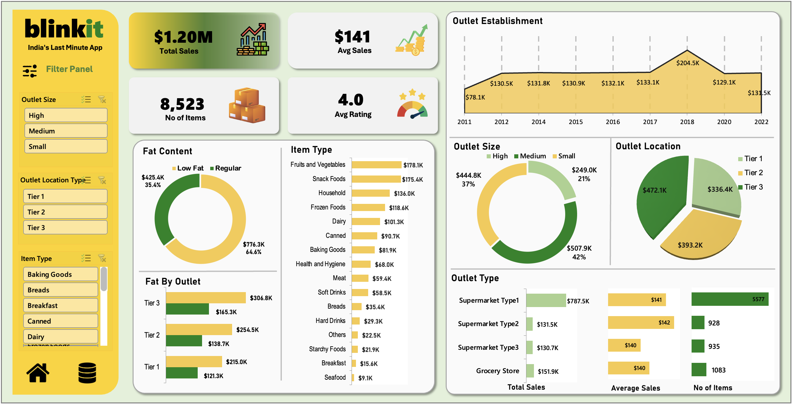

# 🛒 Blinkit Sales Analysis Dashboard – Microsoft Excel

## 📌 Project Overview

This project presents an interactive **Blinkit Sales Analysis Dashboard** developed using Microsoft Excel. The dashboard provides a comprehensive overview of sales performance, product categories, outlet characteristics, and customer ratings.

The objective of this project is to transform raw sales data into meaningful insights through interactive visualizations, KPIs, and filters, helping businesses understand sales trends and make data-driven decisions.

## 📊 Dashboard Preview

## 🎯 Key Performance Indicators (KPIs)

The dashboard highlights four major performance indicators:

- **Total Sales:** $1.20M
- **Average Sales:** $141
- **Number of Items:** 8,523
- **Average Rating:** 4.0

## 📈 Dashboard Features

### 1. Outlet Establishment Analysis
- Analyzes sales performance based on outlet establishment year.
- Identifies sales trends across different years.
- Highlights the highest-performing establishment year.

### 2. Fat Content Analysis
- Compares sales generated by Low Fat and Regular products.
- Visualizes the contribution of each category to total sales.

### 3. Item Type Analysis
- Evaluates sales performance across different product categories.
- Identifies top-performing and low-performing item types.
- Helps understand product category contributions.

### 4. Outlet Size Analysis
- Compares sales across High, Medium, and Small outlets.
- Analyzes the contribution of different outlet sizes to overall sales.

### 5. Outlet Location Analysis
- Examines sales distribution across Tier 1, Tier 2, and Tier 3 locations.
- Helps identify location-wise sales performance.

### 6. Outlet Type Analysis
- Compares different outlet types based on:
  - Total Sales
  - Average Sales
  - Number of Items

## 🎛️ Interactive Filters (Slicers)

The dashboard includes interactive slicers that allow users to dynamically filter the data based on:

- Outlet Size
- Outlet Location Type
- Item Type

These filters make it easier to explore specific segments and analyze sales performance from different perspectives.

## 🛠️ Tools & Technologies Used

- **Microsoft Excel** – Dashboard development and data visualization.
- **Pivot Tables** – Data summarization and analysis.
- **Pivot Charts** – Interactive graphical representation of data.
- **Slicers** – Dynamic filtering and dashboard interactivity.
- **Data Cleaning** – Preparing and organizing data for analysis.
- **Excel Formulas** – Calculations and KPI development.

## 💡 Key Business Insights

The dashboard helps analyze:

- Overall sales performance and average transaction value.
- Product categories contributing the most to total sales.
- Sales distribution across different outlet sizes.
- Performance comparison between Tier 1, Tier 2, and Tier 3 locations.
- Differences in sales between Low Fat and Regular products.
- Performance of different outlet types.
- Historical sales trends based on outlet establishment year.

## 🎯 Project Objectives

- Develop an interactive Excel dashboard for sales analysis.
- Practice data cleaning and data transformation.
- Build analytical reports using Pivot Tables and Pivot Charts.
- Identify sales trends and category-wise performance.
- Present complex sales data through clear and meaningful visualizations.

## 📚 Skills Demonstrated

- Data Analysis
- Data Cleaning
- Data Visualization
- KPI Development
- Pivot Table Analysis
- Interactive Dashboard Design
- Business Intelligence
- Microsoft Excel

## 👨‍💻 Author

**Anuj Bais**

Aspiring Data Analyst | Excel | Power BI | Tableau | SQL | Python

🔗 **LinkedIn:** [Connect with me](https://www.linkedin.com/in/anujbais-/)

---

⭐ If you find this project useful, consider giving this repository a star!
